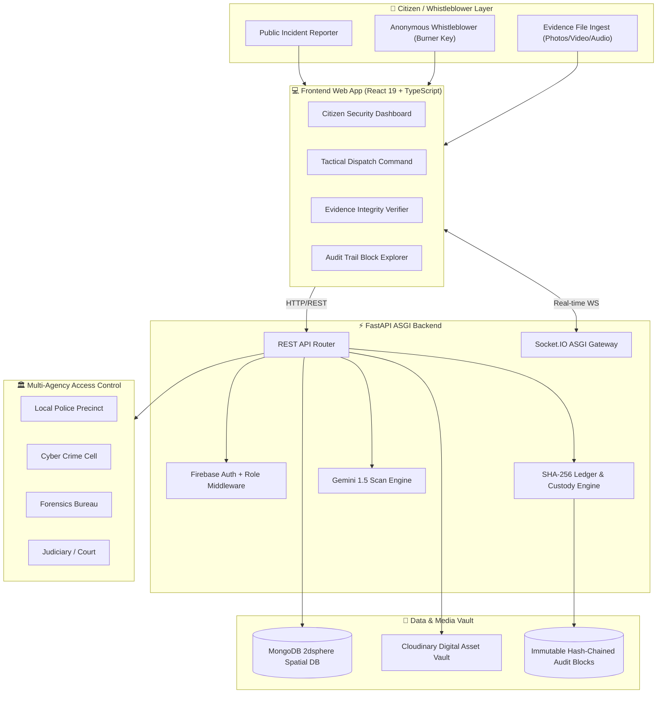

# 🛡️ TRINETRA — Smart Crime Reporting & Immutable Evidence Custody System

[](https://www.python.org/)
[](https://fastapi.tiangolo.com/)
[](https://react.dev/)
[](https://www.typescriptlang.org/)
[](https://tailwindcss.com/)
[](https://www.mongodb.com/)
[](https://pytest.org/)

**Trinetra** is an enterprise-grade, civic security and law enforcement platform that bridges public incident reporting with cryptographic chain-of-custody tracking. It ensures citizen anonymity, prevents digital evidence tampering, automates FIR registration, and coordinates multi-agency dispatch with real-time WebSocket alerts and Google Gemini AI validation.

---

## 🏛️ System Architecture



---

## 🚀 Key Feature Pillars

### 1. 🔏 Tamper-Proof Chain of Custody (Evidence Auditing)
- **Automatic Cryptographic Fingerprinting**: When photos, video, audio, or CCTV clips are uploaded, an **SHA-256** digest is computed immediately.
- **Evidence Custody Ledger**: Every asset is registered with an immutable record (`EVID-XXXXX`), file byte-count, timestamp, and uploading officer identity.
- **Byte-Level Verification Tool**: Citizens, defense attorneys, and judges can drop any candidate file into the verification tool to check if even a single byte was altered after collection.

### 2. 📜 Transparent FIR & Deterministic Lifecycle Tracking
- **Deterministic Pipeline**:
  $$\text{Logged / Reported} \longrightarrow \text{FIR Filed} \longrightarrow \text{Investigating} \longrightarrow \text{Charge-Sheet Submitted} \longrightarrow \text{Resolved}$$
- **Official FIR Lodging**: Authorities formally lodge First Information Reports, minting unique registration identifiers: `FIR-YYYY-MMDD-XXXX` with applicable penal statutes (e.g. BNS 303, IT Act 66D).
- **Cryptographic Audit Trail**: Every status transition seals an immutable ledger block linked to parent block hashes:
  $$\text{block\_hash} = \text{SHA-256}(\text{index} : \text{action} : \text{from\_status} : \text{to\_status} : \text{actor} : \text{prev\_hash})$$
  Any retro-active modification breaks blockchain continuity.

### 3. 🎭 Anonymous Whistleblower Protection (Burner Secret Key Protocol)
- **Zero Identity Link**: Citizens reporting corruption or sensitive crimes can enable **Whistleblower Protocol**. All Firebase UIDs, emails, and IP addresses are completely stripped from database records.
- **Burner Claim Secret**: The reporter receives a unique claim token (`WB-YYYY-XXXXXX`).
- **Zero-Auth Portal**: Whistleblowers can query their report's live FIR registration, police handling, and forensic audit blocks without ever logging in.

### 4. 🏢 Multi-Agency Access Control
- Specialized departmental classification:
  - **Local Police Precinct**
  - **Cyber Crime Cell**
  - **Forensics & Ballistics Bureau**
  - **Judiciary / Magistrate Court**
- Departmental routing triggers cryptographically sealed transfer records in the public audit chain.

### 5. 🤖 Gemini AI Incident Scanner
- Analyzes newly lodged incidents against existing reports in a 5km radius to discover duplicate spams, coordinated incidents, and suspicious anomalies.

### 6. 🔗 Public EVM Blockchain Anchoring (Polygon Amoy Testnet)
- **Solidity Smart Contract** ([`TrinetraEvidenceRegistry.sol`](file:///c:/Users/Asus/OneDrive/Desktop/Trinetra/backend/contracts/TrinetraEvidenceRegistry.sol)): Permanently commits evidence hashes, FIR records, and status transitions onto the Polygon Amoy blockchain.
- **On-Chain Verification Receipts**: Every anchored block generates an authentic EIP-155 receipt with transaction hash (`0x...`), block confirmation number, and direct [Polygonscan Explorer](https://amoy.polygonscan.com) link.

### 7. 📷 On-Scene Camera Hardware Direct-Capture & WebRTC Signature
- **Hardware Direct-Lens Ingest**: Directly captures photos or records live video through device camera sensors via `navigator.mediaDevices.getUserMedia`.
- **Client-Side SHA-256 Signature**: Computes cryptographic hashes in-browser (`window.crypto.subtle`) before byte transmission.
- **Embedded Visual Watermark**: Encodes GPS coordinates (`Lat/Lng`), UTC timestamp, and authentication seal directly onto the media stream canvas.

---

## 🛠️ Tech Stack

| Layer | Technologies |
| :--- | :--- |
| **Backend** | Python 3.12+, FastAPI, Uvicorn, Motor (Async MongoDB), Pydantic v2 |
| **Realtime** | python-socketio (ASGI integrated) |
| **Cryptography** | SHA-256, HMAC, Merkle / Hash-Chained Blocks, Burner Public Keys |
| **AI Engine** | Google Gemini API (`gemini-1.5-flash`) |
| **Authentication** | Firebase Admin SDK, Email OTP dispatch, Mock Auth dev provider |
| **Frontend** | React 19, TypeScript, Tailwind CSS v4, Lucide Icons, Framer Motion |
| **Build Tooling** | Vite 8, Oxlint |
| **Testing** | pytest, pytest-asyncio, mongomock |

---

## 📂 Project Structure

```
Trinetra/
├── backend/
│   ├── app/
│   │   ├── main.py                 # FastAPI bootstrap & ASGI Socket.IO pipeline
│   │   ├── config.py               # Pydantic environment configurations
│   │   ├── db.py                   # Async Motor client with mongomock fallback
│   │   ├── firebase.py             # Firebase Admin authentication & RBAC
│   │   ├── models/
│   │   │   ├── report.py           # Report, FIR, evidence ledger & audit models
│   │   │   ├── user.py             # User profile & onboarding schemas
│   │   │   └── vote.py             # Upvote registry validators
│   │   ├── routes/
│   │   │   ├── auth.py             # Onboarding, OTP service, and superuser sync
│   │   │   ├── reports.py          # Evidence hashing, FIR lodging & lifecycle APIs
│   │   │   └── admin.py            # Administrative analytics & review queue
│   │   └── utils/
│   │       ├── crypto_ledger.py    # SHA-256 hashing, audit chain, and burner tokens
│   │       ├── gemini.py           # Gemini duplicate & suspicion classifier
│   │       ├── geocoding.py        # Reverse geocoding (lat/lng -> address)
│   │       └── socket_manager.py   # Socket.IO room broadcasters
│   ├── tests/
│   │   └── test_api.py             # 16 automated unit & cryptographic tests
│   └── requirements.txt            # Python dependencies
│
├── frontend/
│   ├── src/
│   │   ├── components/
│   │   │   ├── CitizenDash.tsx     # Citizen report feed & whistleblower submission
│   │   │   ├── AuthorityDash.tsx   # Dispatch stream, FIR lodging & lifecycle command
│   │   │   ├── AdminDash.tsx       # System admin console & verification reviews
│   │   │   ├── EvidenceAuditModal.tsx # SHA-256 Drag-and-Drop Integrity Checker
│   │   │   ├── AuditTrailModal.tsx # Immutable Hash-Chained Ledger Explorer
│   │   │   ├── LodgeFirModal.tsx   # Formal FIR lodging modal
│   │   │   ├── WhistleblowerTrackModal.tsx # Zero-auth burner claim tracker
│   │   │   └── AuthModal.tsx       # Firebase & OTP login modal
│   │   ├── hooks/
│   │   │   ├── useAuth.tsx         # Auth state, session sync & superuser role switcher
│   │   │   └── useReports.ts       # Report management, crypto auditing & FIR APIs
│   │   ├── utils/
│   │   │   ├── api.ts              # Axios client with Bearer token injection
│   │   │   └── socket.ts           # Socket.IO client connection
│   │   └── App.tsx                 # Dynamic role router with floating superuser switcher
│   ├── package.json
│   └── vite.config.ts
│
├── IMPLEMENTATION_PLAN.md          # Multi-phase roadmap and delivery milestones
└── README.md                       # Main documentation guide
```

---

## ⚙️ Environment Configuration

### Backend Setup (`backend/.env`)
Create `backend/.env` containing:
```ini
PORT=8000
HOST=0.0.0.0
ENVIRONMENT=development

# MongoDB Connection (Auto-falls back to In-Memory Mock if offline)
MONGO_URI=mongodb://localhost:27017
MONGO_DB_NAME=trinetra

# Firebase Auth Configuration
FIREBASE_PROJECT_ID=trinetra-4e6bb
FIREBASE_CREDENTIALS_PATH=firebase-credentials.json

# External API Integrations
GEMINI_API_KEY=your-gemini-api-key
MAPBOX_API_KEY=your-mapbox-api-key
CLOUDINARY_CLOUD_NAME=your-cloud-name
CLOUDINARY_API_KEY=your-api-key
CLOUDINARY_API_SECRET=your-api-secret

# Local Dev Auth Mock Mode
MOCK_AUTH_ENABLED=true
MOCK_AUTH_SECRET=trinetra_development_secret
```

---

## 🏃 Running the Application

### Option A: One-Command Docker Compose (Recommended for Production)
Orchestrates MongoDB 7.0, Redis 7.0, the FastAPI backend, and the Nginx-served React frontend with health checks:
```bash
docker compose up --build
```
- Frontend Web App: `http://localhost:3000`
- FastAPI REST & WebSocket API: `http://localhost:8000`
- API Health & Metrics: `http://localhost:8000/health` & `http://localhost:8000/metrics`

---

### Option B: Local Developer Mode

#### 1. Start the Backend API
```bash
# Navigate to backend
cd backend

# Install dependencies
pip install -r requirements.txt

# Run FastAPI with Uvicorn
uvicorn app.main:socket_app --host 0.0.0.0 --port 8000 --reload
```
API will be live at: `http://localhost:8000` (Swagger UI: `http://localhost:8000/docs`)

#### 2. Start the Frontend Application
```bash
# Navigate to frontend
cd frontend

# Install dependencies
npm install

# Start Vite dev server
npm run dev
```
Client UI will be live at: `http://localhost:5173`

---

## 🧪 Testing & Validation

### Run Backend Tests (18 Tests)
```bash
pytest backend/tests
```
Verifies:
- Health check & auth sync
- Observability `/health` and `/metrics` routes
- Citizen, Authority, and Admin RBAC
- Report creation & duplicate prevention
- **SHA-256 evidence hashing & upload receipt verification**
- **Deterministic FIR generation & audit trail continuity**
- **Whistleblower anonymous submission & zero-auth lookup**
- **Blockchain anchoring on Polygon Amoy testnet**

### Run Frontend Build
```bash
cd frontend
npm run build
```
Validates full TypeScript typing and compiles production assets with Vite.

---

## 👑 Superuser Testing Persona
The email account **`anshshrivastav9480@gmail.com`** is configured as a global superuser across all environments. When logged in with this account:
- All endpoints bypass role restrictions.
- An interactive floating role-switcher appears in the UI allowing instant previews across **Citizen**, **Authority (Police)**, and **Admin** dashboards without re-logging.
